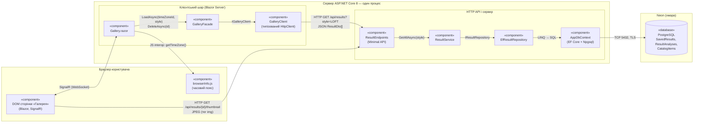

# Діаграма компонентів — перегляд галереї (ЛР №9)

**Операція:** користувач відкриває «Галерею» і обирає стиль — `GET /api/results?style=LOFT` (FR-15, FR-22). Саме цю операцію вимірювали в JMeter ([profile.md](../quality/profile.md)).

**Стан коду:** `dev` після ЛР №9 (фасад галереї — S3, фільтр за стилем — S3). Класи всередині компонентів — [implementation.md](implementation.md).

## Компоненти

| Компонент | Відповідальність | Надає | Потребує | Код |
|---|---|---|---|---|
| DOM сторінки (браузер) | показ карток, список стилів, кліки; мініатюри завантажує сам за адресою `thumbnailUrl` | — | SignalR-з'єднання з сервером, `GET …/thumbnail` | розмітка `Gallery.razor`, `Gallery.razor.css` |
| browserInfo.js | часовий пояс браузера для дати на картці | `getTimeZone()` | — | `wwwroot/js/browserInfo.js` |
| Gallery.razor | стан сторінки (завантаження, фільтр, підтвердження видалення), показ результату фасаду | сторінку `/gallery` | `GalleryFacade`, JS interop | `Components/Pages/Gallery.razor` |
| GalleryFacade | єдина точка входу для сторінки: картки або текст помилки, повідомлення «робіт стилю немає» | `LoadAsync(timeZoneId, style)`, `DeleteAsync(id)` | `IGalleryClient` | `Clients/Gallery/GalleryFacade.cs` (+ `GalleryItemView`, `GalleryErrorMessages`, `BrowserTimeZone`) |
| GalleryClient | HTTP-виклики API галереї, відмова → виняток зі статусом | `IGalleryClient` | `HttpClient` (`ApiBaseUrl`) | `Clients/GalleryClient.cs` |
| ResultEndpoints | контракт API: перевірка `style` (невідомий → 400 ProblemDetails), DTO | `GET /api/results?style=`, `GET /api/results/{id}/thumbnail`, `POST`, `DELETE` | `ResultService` | `Api/Endpoints/ResultEndpoints.cs` |
| ResultService | правила галереї (ліміт робіт, мініатюри — при збереженні); при читанні передає фільтр у сховище | `GetAllAsync(style)` | `IResultRepository` | `Services/Results/ResultService.cs` |
| EfResultRepository | запит до БД: фільтр за стилем аналізу, нові спершу, без байтів зображень | `IResultRepository` | `AppDbContext` | `Repositories/EfResultRepository.cs` |
| AppDbContext | мапінг сутностей на таблиці, переклад LINQ у SQL | `DbSet<SavedResult>` та ін. | Npgsql, рядок підключення з `.env` | `Data/AppDbContext.cs` |
| PostgreSQL (Neon) | зберігання робіт і аналізу | таблиці `SavedResults`, `ResultAnalyses`, `CatalogItems` | — | міграції `Data/Migrations/` |

## Як проходить операція

1. Користувач обирає стиль → браузер передає подію через **SignalR** у `Gallery.razor` (Blazor Server: код сторінки виконується на сервері).
2. `Gallery.razor` викликає `GalleryFacade.LoadAsync(timeZoneId, style)`; часовий пояс узято раз через `browserInfo.js`.
3. Фасад → `GalleryClient` → **HTTP** `GET /api/results?style=LOFT` до власного API (той самий процес, але через HTTP — межа клієнт / сервер з S1).
4. `ResultEndpoints` перевіряє `style` → `ResultService` → `EfResultRepository` → один SQL-запит через `AppDbContext` до **Neon** (з `JOIN ResultAnalyses`, `WHERE Style`, `ORDER BY CreatedAt DESC`).
5. Відповідь `ResultDto[]` → фасад робить картки → сторінка перемальовується; мініатюри браузер завантажує окремими запитами `GET /api/results/{id}/thumbnail`.

**Що вимірює JMeter:** кроки 3–4 — від HTTP-запиту до API до відповіді (`Api → Service → Repo → Ctx → Db`). Найдовша ланка — мережа до хмарної БД; тому критерій p95 ≤ 500 мс і тестова БД — окрема гілка Neon.
