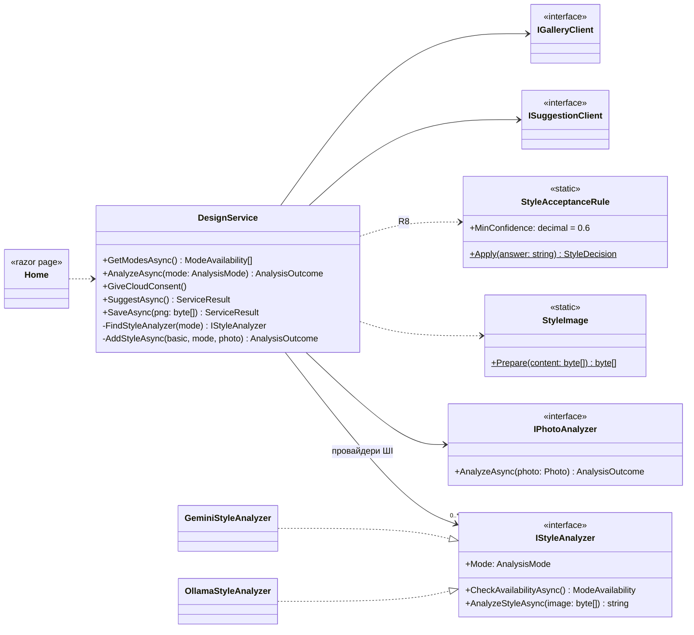
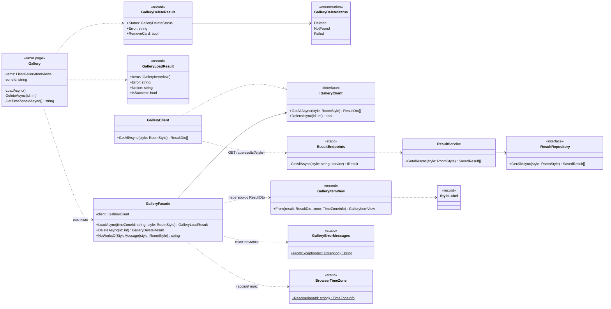

# Діаграма класів реалізації

**Що показує:** фактичні класи коду (сторінки, клієнти, ендпоінти, сервіси, репозиторії) і залежності між ними — для частин, що змінюються в S3 (ЛР №7). Предметна модель і таблиці БД — [model/class-diagram.md](../../model/class-diagram.md).

**Стан:** розд. 1–2 — після S2, початковий коміт рефакторингу S3 `d9709ab`; розд. 3 — після рефакторингу (лише змінені класи й залежності).

## 1. Галерея — до рефакторингу (S2)

Сторінка `Gallery.razor` сама звертається до клієнта й трьох помічників; помічники лежать у серверному шарі `Services/Results`, `Services/Modes`.

## 2. Аналіз стилю (S2)

`DesignService` сам обирає провайдера ШІ за режимом, готує зображення, рахує тайм-аут і застосовує R8 (кандидат на другий фасад — за бажанням).

## 3. Після рефакторингу (S3)

Шаблон **Фасад** (#52, коміти `refactor:`). `Gallery.razor` звертається лише до `GalleryFacade`; клієнт, перетворення карток, тексти помилок і часовий пояс — за фасадом. Обробка помилок, що повторювалась у кожній дії сторінки, — в одному місці. UI-помічники перенесено із серверного шару `Services/Results`, `Services/Modes` у клієнтський: `Clients/Gallery` (галерея) і `Clients/Design` (сторінка «Дизайн»). Поведінку зафіксовано тестами S3-2 (`GalleryScenarioTests`) — вони проходять до й після.

Показано лише змінене. Нова операція S3-3 (FR-22, коміт `feat:`) — параметр `style` по всьому ланцюжку: `GalleryFacade.LoadAsync` → `IGalleryClient.GetAllAsync` → `GET /api/results?style=` → `ResultService` → `IResultRepository` (`EfResultRepository`, `InMemoryResultRepository`). Невідомий стиль — `400` (AC-38); робіт стилю немає — `Notice` з назвою стилю (AC-37).

| Було | Стало |
|---|---|
| `Gallery` → `IGalleryClient`, `GalleryItemView`, `GalleryErrorMessages`, `BrowserTimeZone` | `Gallery` → `GalleryFacade` |
| `try/catch` у `LoadAsync` і `DeleteAsync` сторінки | у `GalleryFacade`; сторінка отримує готовий текст (`Error`) |
| `Services/Results`: `GalleryItemView`, `GalleryErrorMessages`, `BrowserTimeZone`, `DesignDownloadName` | `Clients/Gallery`: перші три; `Clients/Design`: `DesignDownloadName` |
| `Services/Modes`: `AnalysisModePicker`, `AnalysisResultView`, `StyleLabel` | `Clients/Design` |

## Позначення

`..>` — залежність (використовує), `-->` — асоціація (поле, отримане через конструктор), `..|>` — реалізує інтерфейс; `$` — статичний член; `<<razor page>>` — сторінка Blazor (`.razor`).