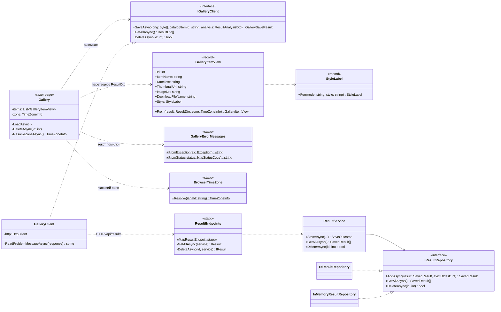
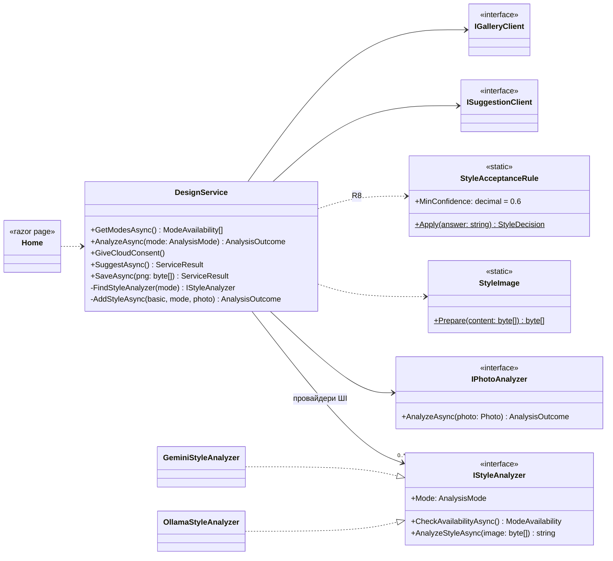

# Діаграма класів реалізації

**Що показує:** фактичні класи коду (сторінки, клієнти, ендпоінти, сервіси, репозиторії) і залежності між ними — для частин, що змінюються в S3 (ЛР №7). Предметна модель і таблиці БД — [model/class-diagram.md](../../model/class-diagram.md).

**Стан:** після S2 — початковий коміт рефакторингу S3 `d9709ab`. Після рефакторингу оновлюються лише змінені класи й залежності (розд. 3).

## 1. Галерея — до рефакторингу (S2)

Сторінка `Gallery.razor` сама звертається до клієнта й трьох помічників; помічники лежать у серверному шарі `Services/Results`, `Services/Modes`.

## 2. Аналіз стилю (S2)

`DesignService` сам обирає провайдера ШІ за режимом, готує зображення, рахує тайм-аут і застосовує R8 (кандидат на другий фасад — за бажанням).

## 3. Після рефакторингу (S3)

*Заповнюється в S3-1: `GalleryFacade` між `Gallery.razor` і клієнтом / помічниками; помічники — у клієнтському шарі; метод фільтра за стилем (S3-3).*

## Позначення

`..>` — залежність (використовує), `-->` — асоціація (поле, отримане через конструктор), `..|>` — реалізує інтерфейс; `$` — статичний член; `<<razor page>>` — сторінка Blazor (`.razor`).