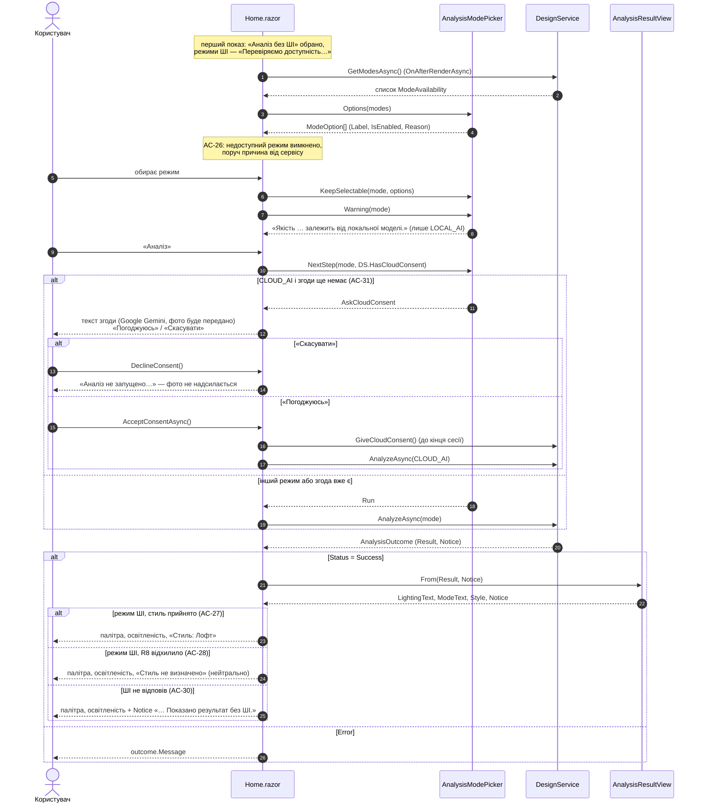

# Sequence Diagram — UC-01. Завантажити фото приміщення

**Автор:** Блонський Іван. **Вимоги:** FR-01, FR-13, NFR-04, NFR-06.
**Специфікація:** [UC-01](../../use-cases.md#uc-01-завантажити-фото-приміщення), [Activity UC-01](../../../model/activity-uc-01.md).

Діаграма побудована за фактичним кодом: імена учасників — класи, повідомлення — методи.

```mermaid
sequenceDiagram
    autonumber
    actor U as Користувач
    participant P as Home.razor
    participant DS as DesignService
    participant IS as ImageSharp (Image)
    participant PH as Photo
    participant C as PhotoCanvas
    participant S as DesignSession

    U->>P: обирає файл або робить знімок (FR-01)
    P->>DS: CheckFileSize(file.Size)
    alt A2: файл > 10 МБ
        DS-->>P: ServiceResult.Fail(TooLargeMessage)
        P-->>U: причина відмови, сесія без змін
    else розмір допустимий
        DS-->>P: ServiceResult.Ok()
        P->>P: OpenReadStream → byte[] (лише в пам'яті, NFR-04)
        P->>DS: LoadPhotoAsync(fileName, content, _canvas.SetPhotoAsync)
        alt уже йде інше завантаження (IsLoadingPhoto)
            DS-->>P: Fail(PhotoLoadInProgressMessage)
        else іде аналіз (FR-13)
            DS-->>P: Fail(PhotoReplaceBlockedMessage)
        else
            DS->>DS: ReadPhoto(fileName, content)
            DS->>IS: Image.Identify(stream)
            IS-->>DS: Width, Height, DecodedImageFormat
            DS->>PH: new Photo { Format, Width, Height, SizeBytes, Content }
            DS->>PH: Validate()
            alt A2: не JPEG/PNG або менша сторона < 480 px (NFR-06)
                PH-->>DS: false, RejectionReason
                DS-->>P: ServiceResult.Fail(RejectionReason)
                P-->>U: причина відмови; полотно й сесія без змін (A4)
            else фото коректне
                PH-->>DS: true
                Note over DS: IsLoadingPhoto = true<br/>(друге завантаження й аналіз відхиляються)
                DS->>C: showOnCanvas(content) = SetPhotoAsync(content)
                alt браузер не показав фото
                    C-->>DS: виняток
                    DS-->>P: Fail(PhotoShowFailedMessage)
                else фото на екрані
                    C-->>DS: ok
                    DS->>DS: LoadPhoto(photo)
                    DS->>S: ReplacePhoto(photo)
                    Note over S: ClearResults() — скидає аналіз,<br/>пропозиції й розміщення (FR-13, A1)<br/>State = PHOTO_LOADED
                    DS-->>P: ServiceResult.Ok()
                    P-->>U: «Фото завантажено. Натисніть «Аналіз».»
                end
                Note over DS: finally: IsLoadingPhoto = false
            end
        end
    end
```

## Пояснення

- **Порядок «перевірка → полотно → сесія»** задає `DesignService.LoadPhotoAsync`, а не сторінка. Невалідне фото не потрапляє ні на полотно, ні в сесію (A2, A4); це перевіряють тести `AC02_*` у `PhotoUploadTests`.
- **Одночасні завантаження:** поки `LoadPhotoAsync` чекає полотно, `IsLoadingPhoto = true`: друге завантаження й `AnalyzeAsync` відхиляються, а на сторінці вимкнені обидва поля вибору й кнопка «Аналіз». Прапорець скидається у `finally`.
- **Формат і розміри — за вмістом файла** (`Image.Identify`), а не за `ContentType` з браузера: WebP, перейменований у `.jpg`, відхиляється.
- **Камера (FR-01, A3)** — кнопка з `capture="environment"`, показується на пристроях із сенсорним екраном (`any-pointer: coarse`). Якщо камера недоступна, браузер відкриває вибір файла, а підказка пропонує обрати фото з галереї.
- **NFR-04:** фото існує лише як `byte[]` у пам'яті сесії; на диск і в зовнішні сервіси не передається.

---

# Sequence Diagram — S2. Вибір режиму аналізу й згода (сторінка «Дизайн»)

**Автор:** Блонський Іван. **Задача:** S2-6 (#63). **Вимоги:** FR-18, FR-19, FR-21, NFR-04; AC-26, AC-27, AC-28, AC-30, AC-31, AC-32.
**Логіка аналізу й R8:** [UC-02 (Фріз)](UC-02-friz.md). Тут — лише те, що робить інтерфейс.

Діаграма побудована за фактичним кодом: `Home.razor` нічого не вирішує сам — тексти й стан кнопок дає `AnalysisModePicker` / `AnalysisResultView`.



## Пояснення

- **Режими (FR-18):** «Аналіз без ШІ» обрано за замовчуванням і завжди доступний — навіть якщо перевірка повернула інше або впала (`OptionsAfterCheckFailed`). Якщо обраний режим став недоступним після «Перевірити ще раз», `KeepSelectable` повертає «Аналіз без ШІ».
- **Згода (NFR-04, AC-31):** питаємо лише для «Хмарний ШІ» і лише поки `DesignService.HasCloudConsent = false`. Без згоди `AnalyzeAsync` не викликається; до того ж сервіс сам відхиляє `CLOUD_AI` без згоди. `DesignService` — Scoped, тож згода діє до кінця сесії (з'єднання).
- **Стиль (FR-19):** рядок про стиль будує `StyleLabel` — той самий для сторінки й картки галереї. У «Аналіз без ШІ» рядка немає; «Стиль не визначено» показано приглушено, не червоним.
- **Галерея (AC-32):** `GalleryItemView.From(ResultDto)` → `StyleLabel.For(analysisMode, style)`. Роботи, збережені до S2 або без ШІ, — без рядка про стиль.
- **Тести:** `AnalysisModePickerTests`, `AnalysisResultViewTests`, `StyleLabelTests`, `GalleryItemViewTests` (`AC26_*`, `AC30_*`, `AC31_*`, `AC32_*`).
