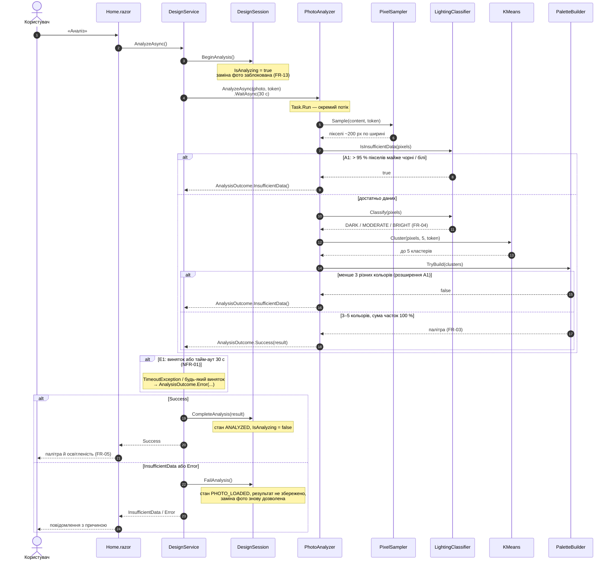

# Sequence Diagram — UC-02. Проаналізувати фото приміщення

**Автор:** Фріз Богдан. **Вимоги:** FR-03, FR-04, FR-05, FR-13, NFR-01, NFR-04; **S2:** FR-18, FR-19, R8, CR-05 (AC-26…AC-28, AC-30, AC-31).
**Специфікація:** [UC-02](../../use-cases.md#uc-02-проаналізувати-фото-приміщення), [Activity UC-02](../../../model/activity-uc-02.md).

Діаграми побудовано за фактичним кодом: імена учасників — класи, повідомлення — методи. Розділ 1 — сценарій із режимами аналізу (S2), розділ 2 — аналіз палітри й освітленості всередині `PhotoAnalyzer` (без змін з v1).

## 1. Режими аналізу й стиль кімнати (S2)

```mermaid
sequenceDiagram
    autonumber
    actor U as Користувач
    participant P as Home.razor
    participant DS as DesignService
    participant S as DesignSession
    participant A as PhotoAnalyzer
    participant SI as StyleImage
    participant AI as IStyleAnalyzer<br/>(Gemini / Ollama)
    participant R8 as StyleAcceptanceRule

    P->>DS: GetModesAsync()
    par LOCAL_AI і CLOUD_AI
        DS->>AI: CheckAvailabilityAsync()
        AI-->>DS: ModeAvailability(доступний, причина)
    end
    DS-->>P: BASIC (завжди) + режими ШІ
    P-->>U: недоступні режими вимкнені з причиною (AC-26)

    U->>P: обирає режим, «Аналіз»
    opt CLOUD_AI, згоди ще немає
        P-->>U: запит згоди на передачу фото Google Gemini
        U->>P: погоджується
        P->>DS: GiveCloudConsent()
    end
    P->>DS: AnalyzeAsync(mode)

    alt CLOUD_AI без згоди (AC-31)
        DS-->>P: Error(CloudConsentRequiredMessage)
        Note over DS: фото не надсилається,<br/>сесія не змінюється
    else
        DS->>S: BeginAnalysis()
        DS->>A: AnalyzeAsync(photo).WaitAsync(30 с)
        Note over A: палітра й освітленість — розділ 2
        A-->>DS: AnalysisOutcome (Success / A1 / E1)

        opt Success і mode ≠ BASIC
            DS->>SI: Prepare(photo.Content)
            SI-->>DS: JPEG, довша сторона ≤ 1024 px
            DS->>AI: AnalyzeStyleAsync(jpeg).WaitAsync(30 с)
            alt відповідь отримано
                AI-->>DS: сирий текст {style, confidence}
                DS->>R8: Apply(answer)
                R8-->>DS: StyleDecision(style або null, confidence)
                Note over DS: Result.Mode = mode;<br/>null — «стиль не визначено» (AC-28)
            else виняток або > 30 с (AC-30)
                Note over DS: Result.Mode = BASIC, стиль null,<br/>Notice: «… не відповів. Показано результат без ШІ.»
            end
        end

        alt Success
            DS->>S: CompleteAnalysis(result)
            Note over S: стан ANALYZED
            DS-->>P: Success (+ Notice)
            P-->>U: палітра, освітленість, стиль (FR-05, FR-19)
        else InsufficientData або Error
            DS->>S: FailAnalysis()
            Note over S: стан PHOTO_LOADED
            DS-->>P: InsufficientData / Error
            P-->>U: повідомлення з причиною
        end
    end
```

## 2. Аналіз палітри й освітленості (v1, без змін)



## Відповідність коду

| Повідомлення | Код |
|---|---|
| `GetModesAsync`, `GiveCloudConsent`, `AnalyzeAsync(mode)`, тайм-аути, відкат на результат без ШІ | `Services/DesignService.cs` → `GetModesAsync`, `AnalyzeAsync`, `RunAnalyzerAsync`, `AddStyleAsync` |
| `CheckAvailabilityAsync`, `AnalyzeStyleAsync` | `Services/Style/IStyleAnalyzer.cs`; `GeminiStyleAnalyzer` (CLOUD_AI), `OllamaStyleAnalyzer` (LOCAL_AI) |
| `Prepare` | `Services/Style/StyleImage.cs` |
| `Apply` (R8) | `Services/Style/StyleAcceptanceRule.cs` |
| промпт і схема відповіді | `Services/Style/style-prompt.txt`, `StylePrompt.cs` |
| `BeginAnalysis`, `CompleteAnalysis`, `FailAnalysis` | `Models/DesignSession.cs` |
| `AnalyzeAsync`, `Analyze` | `Services/Analysis/PhotoAnalyzer.cs` |
| `Sample` | `Services/Analysis/PixelSampler.cs` |
| `IsInsufficientData`, `Classify` | `Services/Analysis/LightingClassifier.cs` |
| `Cluster` | `Services/Analysis/KMeans.cs` |
| `TryBuild` | `Services/Analysis/PaletteBuilder.cs` |

## Рішення S2

- **Спершу палітра, потім ШІ.** Якщо фото не дає палітри (A1) або аналіз не вдався (E1), фото в ШІ не надсилається.
- **Відмова ШІ не ламає аналіз.** Помилка, тайм-аут 30 с чи відсутній провайдер → результат без ШІ (`Mode = BASIC`) і попередження; палітра й освітленість є (AC-30).
- **«Стиль не визначено» — не помилка.** Відповідь не пройшла R8 → стиль `null`, режим лишається ШІ (AC-28).
- **Однаково для всіх провайдерів:** той самий промпт, та сама схема відповіді, R8 — поза провайдером.
- **Згода до відправлення.** Без згоди `AnalyzeAsync(CLOUD_AI)` відмовляє ще до `BeginAnalysis`: фото не залишає сервер (NFR-04, AC-31).

## Відхилення від Activity Diagram

- Перевірка «Достатньо даних?» (A1) виконується **до** кластеризації, а не після: результат для користувача той самий, але на засвіченому фото не витрачається час на k-means.
- **Розширення A1:** однотонне фото (менше 3 різних кольорів після склеювання схожих) теж дає «недостатньо даних», бо FR-03 вимагає 3–5 кольорів.

## Відомі обмеження

- Яскраві акценти малої площі (подушка, картина) можуть не потрапити в палітру: k-means шукає домінантні кольори, дрібні кластери (< 5 %) відкидаються або поглинаються сусідніми.
- Відстань між кольорами рахується в RGB; простір Lab точніше відповідає сприйняттю ока — кандидат на покращення, якщо ручна перевірка AC-03 дасть гірший результат.
- Для сірих кольорів `Hue = 0`; нейтральність кольору треба визначати за насиченістю (`Hex`).
