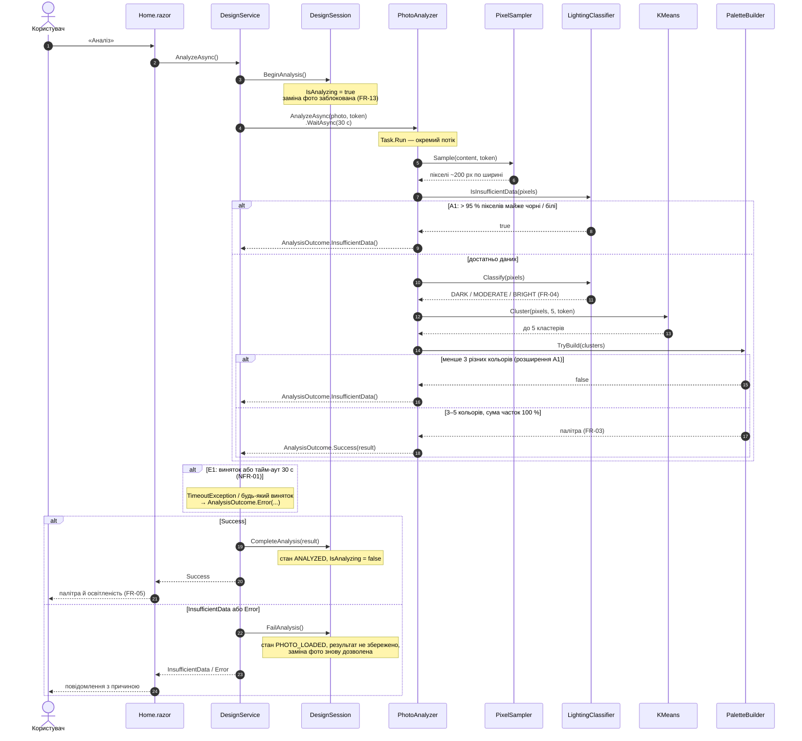

# Sequence Diagram — UC-02. Проаналізувати фото приміщення

**Автор:** Фріз Богдан. **Вимоги:** FR-03, FR-04, FR-05, FR-13, NFR-01, NFR-04.
**Специфікація:** [UC-02](../../use-cases.md#uc-02-проаналізувати-фото-приміщення), [Activity UC-02](../../../model/activity-uc-02.md).

Діаграма побудована за фактичним кодом: імена учасників — класи, повідомлення — методи.

## Відповідність коду

| Повідомлення | Код |
|---|---|
| `AnalyzeAsync()`, тайм-аут, E1 | `Services/DesignService.cs` → `AnalyzeAsync`, `RunAnalyzerAsync` |
| `BeginAnalysis`, `CompleteAnalysis`, `FailAnalysis` | `Models/DesignSession.cs` |
| `AnalyzeAsync`, `Analyze` | `Services/Analysis/PhotoAnalyzer.cs` |
| `Sample` | `Services/Analysis/PixelSampler.cs` |
| `IsInsufficientData`, `Classify` | `Services/Analysis/LightingClassifier.cs` |
| `Cluster` | `Services/Analysis/KMeans.cs` |
| `TryBuild` | `Services/Analysis/PaletteBuilder.cs` |

## Відхилення від Activity Diagram

- Перевірка «Достатньо даних?» (A1) виконується **до** кластеризації, а не після: результат для користувача той самий, але на засвіченому фото не витрачається час на k-means.
- **Розширення A1:** однотонне фото (менше 3 різних кольорів після склеювання схожих) теж дає «недостатньо даних», бо FR-03 вимагає 3–5 кольорів.

## Відомі обмеження

- Яскраві акценти малої площі (подушка, картина) можуть не потрапити в палітру: k-means шукає домінантні кольори, дрібні кластери (< 5 %) відкидаються або поглинаються сусідніми.
- Відстань між кольорами рахується в RGB; простір Lab точніше відповідає сприйняттю ока — кандидат на покращення, якщо ручна перевірка AC-03 дасть гірший результат.
- Для сірих кольорів `Hue = 0`; нейтральність кольору треба визначати за насиченістю (`Hex`).
