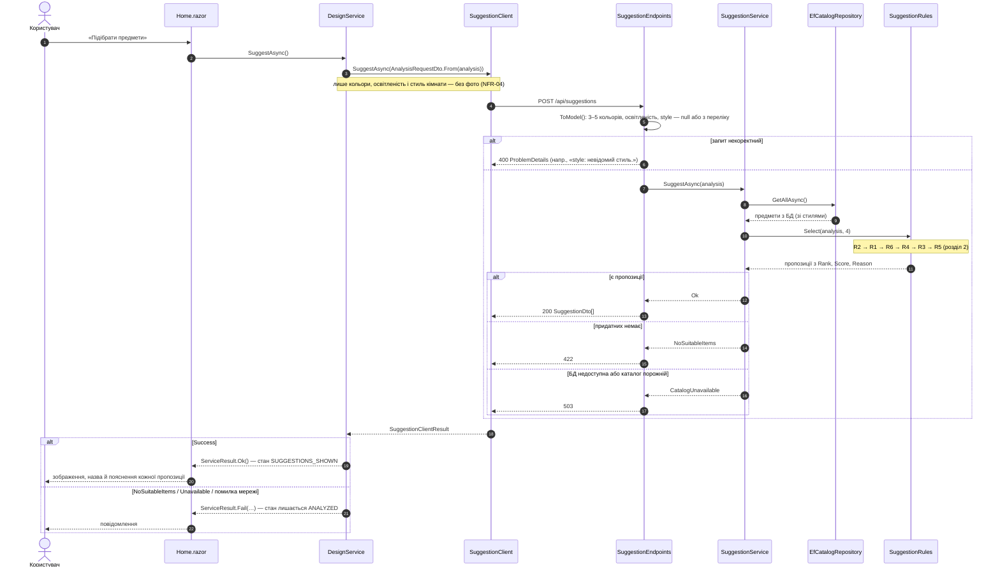
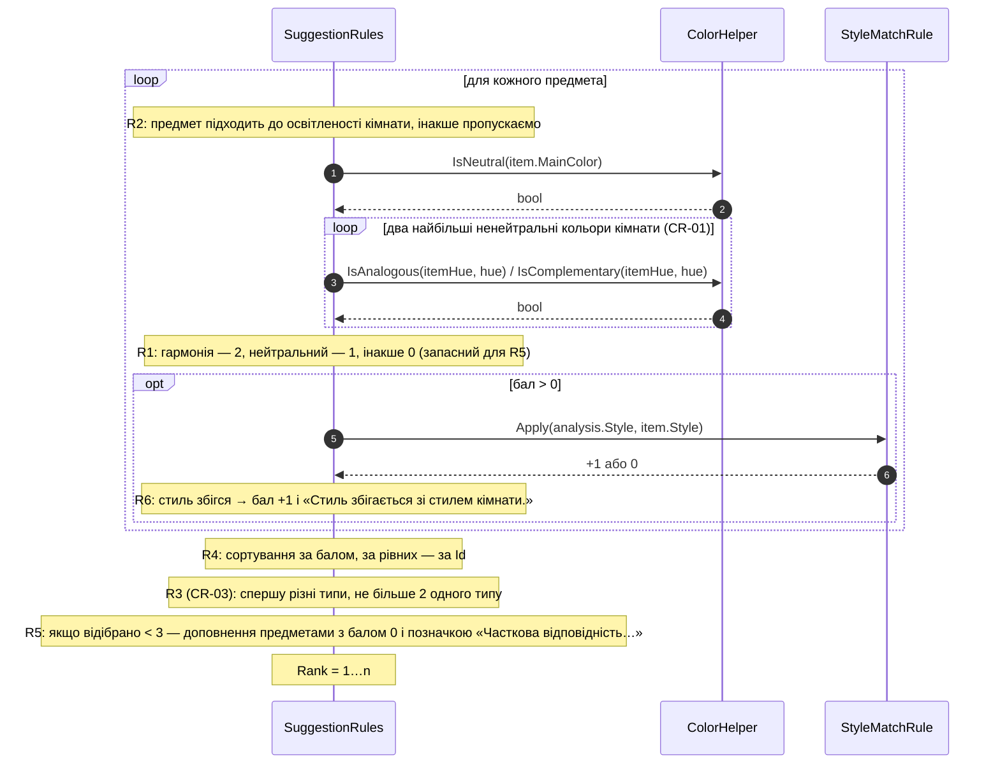

# Sequence Diagram — UC-03. Отримати пропозиції предметів

**Автор:** Онищук Дмитро. **Вимоги:** FR-06, FR-07, R1–R5, AC-06, AC-07; **S2:** FR-20, R6, AC-29.
**Специфікація:** [UC-03](../../use-cases.md#uc-03-отримати-пропозиції-предметів), [Activity UC-03](../../../model/activity-uc-03.md).

Діаграми побудовано за фактичним кодом: імена учасників — класи, повідомлення — методи. Розділ 1 — шлях запиту через HTTP API (S1, S2), розділ 2 — правила добору всередині `SuggestionRules`. Математика кольорів і перевірки гармонії — у `ColorHelper`.

## 1. Запит пропозицій через HTTP API

## 2. Правила добору (`SuggestionRules.Select`)

## Відповідність коду

| Повідомлення | Код |
|---|---|
| `SuggestAsync` | `Services/DesignService.cs` |
| `SuggestAsync`, `POST /api/suggestions` | `Clients/SuggestionClient.cs` |
| `ToModel`, `From` | `Api/Dto/AnalysisRequestDto.cs` |
| ендпоінт, 200 / 400 / 422 / 503 | `Api/Endpoints/SuggestionEndpoints.cs` |
| `SuggestAsync`, `SuggestionOutcome` | `Services/Suggestions/SuggestionService.cs`, `SuggestionOutcome.cs` |
| `GetAllAsync` | `Repositories/EfCatalogRepository.cs` |
| `Select`, `PickDiverse`, `EvaluateItemColor` | `Services/Suggestions/SuggestionRules.cs` |
| `Apply` (R6) | `Services/Suggestions/StyleMatchRule.cs` |
| `IsNeutral`, `IsAnalogous`, `IsComplementary`, `GetHue` | `Services/Analysis/ColorHelper.cs` |

## Рішення S2

- **R6 — лише для предметів, що підійшли за кольором** (бал R1 > 0). Часткові відповідності R5 лишаються з балом 0 і позначкою, інакше бал 1 від стилю змішався б із нейтральним кольором і зламав би `partialMatch`.
- **Стиль не визначено** (`style` = null) → R6 не діє, добір той самий, що без стилю (AC-29).
- R1–R5 не змінено; наявні тести (`SuggestionRulesTests`, `SuggestionRulesSelectionTests`, AC-06, AC-25) проходять без змін.
