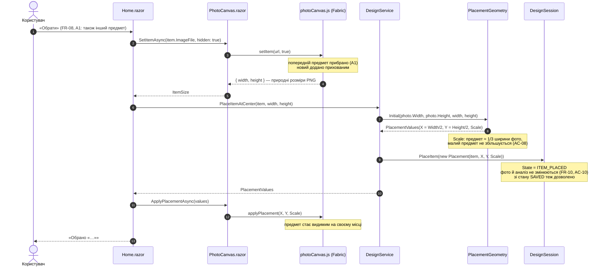
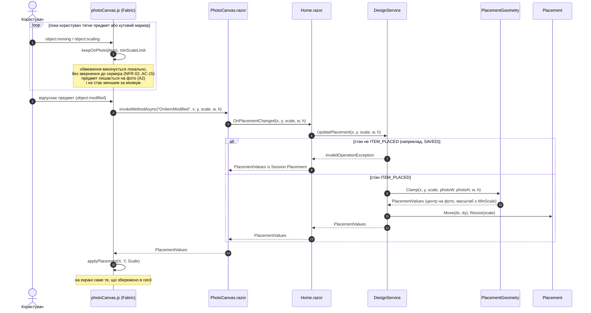
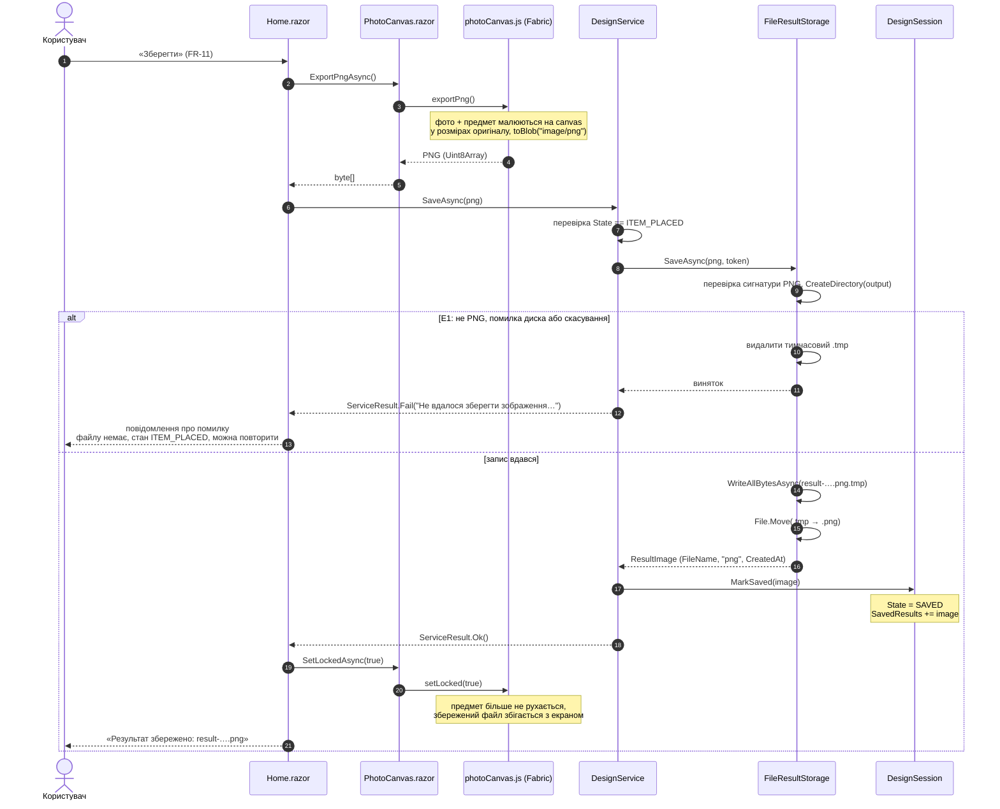

# Sequence Diagram — UC-04. Розмістити предмет на фото й зберегти результат

**Автор:** Семенюта. **Вимоги:** FR-08, FR-09, FR-10, FR-11, NFR-02, NFR-04.
**Специфікація:** [UC-04](../../use-cases.md#uc-04-розмістити-предмет-на-фото-й-зберегти-результат), [Activity UC-04](../../../model/activity-uc-04.md).

Діаграма побудована за фактичним кодом: імена учасників — класи, повідомлення — методи.

## 1. Вибір предмета й початкове розміщення (кроки 1–2, A1)

## 2. Переміщення й зміна розміру (кроки 3–4, A2, NFR-02)

## 3. Збереження результату (кроки 5–7, E1)

## Пояснення

- **Положення рахує сервіс, а не JS.** Початкове центрування (`Initial`), обмеження межами фото й мінімальний розмір (`Clamp`, `MinScale`) — чисті функції `PlacementGeometry`, покриті тестами `AC08_*`, `AC09_*`. JS містить лише дзеркало правила для плавності під час руху, а остаточні значення завжди повертає C# (діаграма 2, кроки 9–15).
- **NFR-02 / AC-15:** під час перетягування звернень до сервера немає. Виклик `OnItemModified` відбувається один раз, коли користувач відпустив предмет. Затримку вимірювано вручну в DevTools (Performance).
- **Предмет з'являється вже на місці:** `setItem(url, hidden: true)` додає його прихованим, а видимим він стає після `applyPlacement`, тому немає «стрибка» зі старого положення.
- **Збереження двоетапне:** файл пишеться як `.tmp`, а потім перейменовується в `.png`. Тому при помилці готового `.png` не з'являється (E1, тести `E1_*` у `FileResultStorageTests`).
- **Стан `SAVED`:** рух предмета заблоковано (`setLocked`), а `UpdatePlacement` у цьому стані кидає виняток, тож збережений файл завжди збігається з екраном. Вибір іншого предмета (A1) повертає сесію в `ITEM_PLACED`.
- **Заміна фото (A3)** — це UC-01: `ReplacePhoto` скидає розміщення (див. [UC-01](UC-01-blonskyi.md)). **Завершення без збереження (A4)** не створює файлу, бо запис відбувається лише в `FileResultStorage.SaveAsync`.
- **NFR-04:** на диск потрапляє лише результат, який користувач зберіг явно. Вхідне фото існує тільки в пам'яті.
