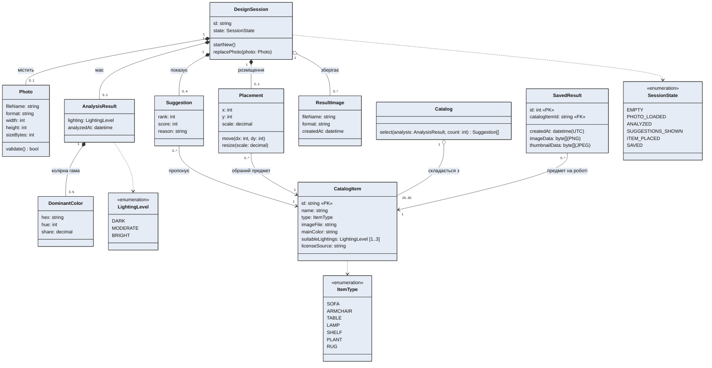

# Діаграма класів

**Інженерне питання:** які предметні сутності, атрибути й зв'язки потрібні застосунку і що з них зберігається в БД.
**Пов'язані вимоги:** FR-01, FR-03…FR-12, NFR-04…NFR-06; v2 (S1): US-1 «Галерея збережених робіт» (#40), #42.
**Пояснення й зміни:** [docs/design.md](../docs/design.md#2-діаграма-класів). Зображення: `docs/images/class-diagram.png` / `.svg`.

## Позначення

- `*--` — композиція (частина не існує без цілого), `o--` — агрегація, `-->` — асоціація з напрямком, `..>` — залежність (клас використовує перелічення).
- Числа на кінцях зв'язків — кратності, як у вимогах: `3..5` кольорів (FR-03), `0..4` пропозиції (FR-06), `20..30` позицій каталогу (FR-12).
- `«PK»` — первинний ключ, `«FK»` — зовнішній ключ таблиці БД.

## Відповідність таблицям БД (S1)

| Клас | Таблиця | Ключ | Примітка |
|---|---|---|---|
| `CatalogItem` | `CatalogItems` | `Id` (рядок, напр. `sofa-01`) | заповнюється з `catalog.json` (`CatalogSeeder`) |
| `SavedResult` | `SavedResults` | `Id` (ціле, генерує БД) | `CatalogItemId` → `CatalogItems.Id`, видалення предмета — `Restrict` |

Решта класів у БД не зберігається: вони живуть у межах сесії користувача (NFR-04).

## Як оновити зображення

Блок `mermaid` вище — текстове джерело моделі (GitHub показує його як діаграму). Зображення для звіту `docs/images/class-diagram.svg` / `.png` намальоване в стилі діаграм v1 (ручне розташування класів): у SVG кожен клас — прямокутник із заголовком і рядками атрибутів, зв'язок — лінія з підписами кратностей.

Під час зміни моделі оновлюємо обидва: атрибути й зв'язки — у блоці `mermaid`, той самий клас або рядок — у `class-diagram.svg` (текстовий файл, редагується як XML); PNG — експорт SVG у браузері (1990×1260).
